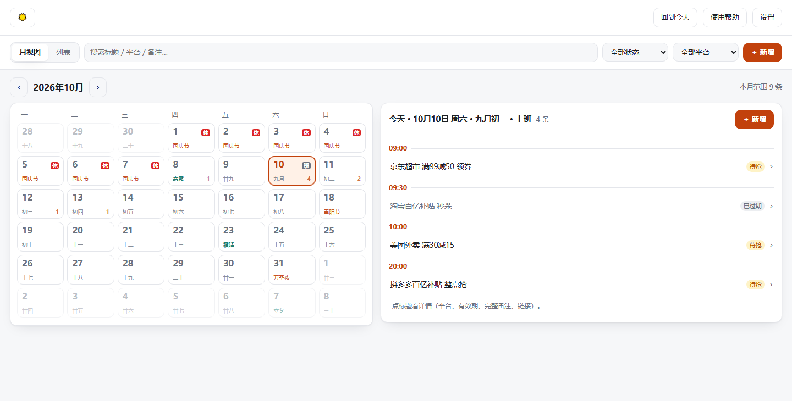
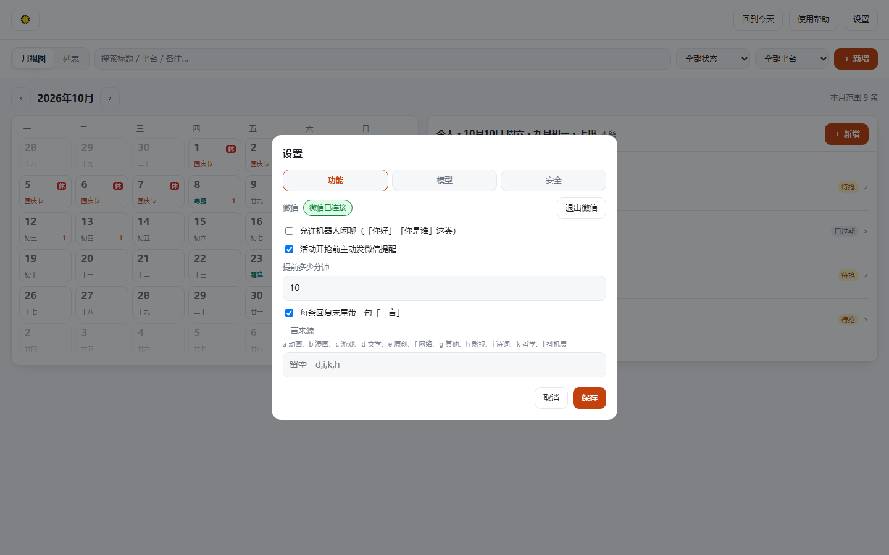
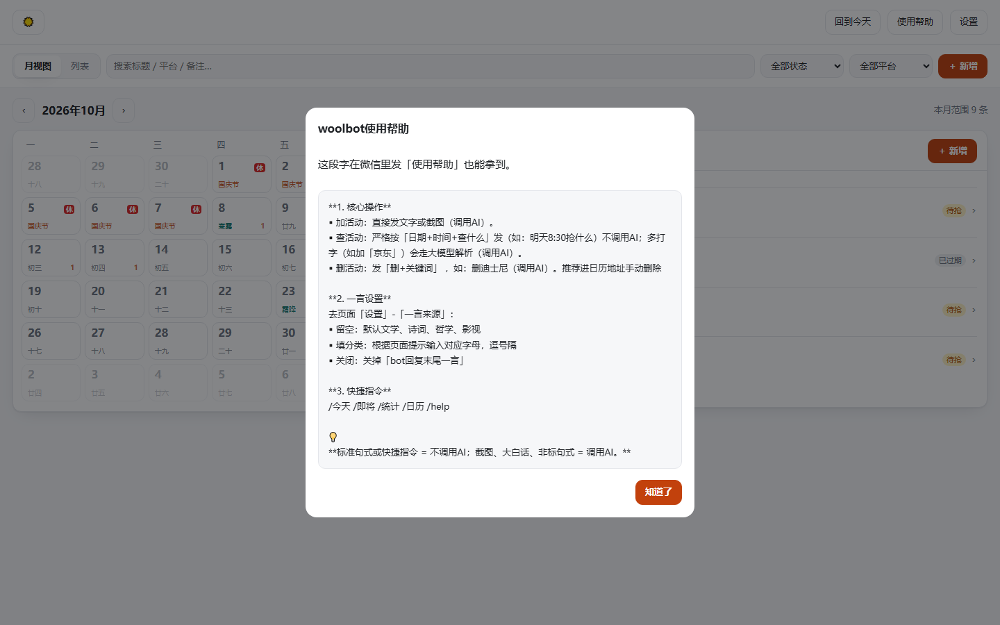

# 🐑 羊毛日历（woolbot）

**微信里发一句话或一张截图，它替你记下来，到点主动提醒，网页日历上总览。**

跑在你自己的机器上：一个容器 + 一个 SQLite 文件，除了 AI 接口不依赖任何外部服务。

- **录入不用记格式**：文字、大白话、活动截图都能丢给它，AI 拆成「平台 / 时间 / 备注 / 链接」
- **查起来不用等 AI**：「明天8:30抢什么」这类标准句式直接查库回答，一次模型都不调
- **到点提醒**：开抢前主动发微信（默认提前 10 分钟，可设 5–1440）
- **重复与配额**：每天 / 每周几 / 每月几号，连「每周限领 1 张」「每月最多 2 次」一起记，领满自动收口
- **网页日历**：月视图 + 农历 / 节气 / 法定节假日（含调休），手机电脑都能开
- **一言**：每条回复末尾可以带一句诗词、哲学或抖机灵

## 界面预览







> 图里是 `python tools/seed_demo.py` 生成的**演示数据**，不是任何人的真实活动。

## 一键部署

### 方式 A：一条命令推到你自己的服务器（推荐）

前提：目标机器装好 **Docker**、开了 **SSH**、你能用密钥登上去。

```bash
git clone https://github.com/susclem/woolbot.git
cd woolbot
export NAS_HOST=你的服务器IP        # Windows: $env:NAS_HOST="…"
export NAS_USER=你的登录用户
export NAS_KEY=~/.ssh/id_ed25519   # 私钥路径，默认就是这条
python deploy/deploy_woolbot.py
```

它会：连上机器 → 建目录 → 上传代码 → `docker compose build && up -d` → 打印一条**能直接点开的地址**。
目标机上如果已经有 `config.json`，它会**复用**，不会覆盖你填好的 key、口令和数据库。

### 方式 B：在服务器上自己拉

```bash
git clone https://github.com/susclem/woolbot.git
cd woolbot
cp config.example.json config.json    # 仓库里不含 config.json，也不含任何 key
vi config.json                        # 至少填 providers.deepseek.api_key
docker compose up -d --build          # 起来后：http://<服务器IP>:16886/
```

容器只监听 **16886**；数据走 `./data` 挂载（重建容器不丢）。想让 `data/` 归你自己的用户：

```bash
WOOLBOT_UID=$(id -u) WOOLBOT_GID=$(id -g) docker compose up -d
```

### 方式 C：本机先试跑（不用 Docker）

```bash
python -m venv .venv && . .venv/bin/activate   # Windows: .venv\Scripts\activate
pip install -r requirements.txt
cp config.example.json config.json             # 同上，填一个 API key
python main.py check                           # 自检：配置、时区、数据库
python main.py all                             # 网页 + 机器人一起跑
# 只要网页：python main.py web      只想在命令行聊：python main.py chat
```

打开 `http://127.0.0.1:16886/`。`deploy/README.md` 里有那四个部署脚本的分工和全部环境变量。

## 开箱即用三步

**1. 设置 AI 模型（必做）**
页面右上角「设置」→「模型」：填 **Base URL**（DeepSeek 是 `https://api.deepseek.com`）、
**API Key**（`sk-…`）、**模型**，点「测试连接」确认通了再保存。
没有 key 时日历照样能用，只是机器人读不懂你发的消息。截图识别默认用同一个模型键，
想单独配就在 `config.json` 里写 `vision_model`。

**2. 绑定微信 ClawBot（要用微信收发消息就做）**
「设置」→「功能」→「微信」，用微信扫那个二维码（约 5 分钟失效，过期会自动换一张）。
连上后顶栏胶囊会变「微信已连接」。要解绑：点「退出微信」清掉本机登录态，
再去微信里「解除连接」。

**3. 按个人需求设置「安全」**
「设置」→「安全」：

| 开关 | 作用 |
|---|---|
| 打开页面需要口令（`?token=…`） | 给页面加一把口令，适合放到公网 |
| 用外网域名访问 | 填你的域名，二维码和链接按它生成 |
| 打开页面要访问秘钥 | 再加一层登录（≥ 8 位）；「退出登录」= 所有设备一起失效 |

> 提醒默认**提前 10 分钟**（5–1440 可调）。想让它陪你闲聊（「你好」「你是谁」）就在
> 「功能」里打开「允许机器人闲聊」——默认关着，省额度。

## 微信里怎么用

| 想干的事 | 怎么发 | 用不用 AI |
|---|---|---|
| 加活动 | 直接发文字或截图 | 用 |
| 查活动 | **「日期 + 时间 + 查什么」**，如「明天8:30抢什么」 | 不用 |
| 查活动（大白话） | 多打几个字，如「明天8:30京东有什么」 | 用 |
| 删活动 | 「删 + 关键词」，如「删迪士尼」 | 用 |
| 快捷指令 | `/今天` `/即将` `/统计` `/日历` `/help` | 不用 |

**标准句式或快捷指令 = 不调用 AI；截图、大白话、非标句式 = 调用 AI。**

## 目录一览

| 路径 | 干什么 |
|---|---|
| `main.py` | 入口：`web` / `chat` / `bot` / `all` / `check` / `backfill-repeat` |
| `app/pipeline.py` | 消息处理主流程；微信里的「使用帮助」文案（`HELP_TEXT`）唯一权威也在这 |
| `app/llm.py` | 提示词与模型调用：文字理解 + 截图理解两套 |
| `app/repeat.py` | 重复规则与配额：解析「每天 / 每周几 / 每月几号」「每周几次」、算场次 |
| `app/db.py` | SQLite：活动、按天领到的台账、托盘消息 |
| `app/wechat.py` | ClawBot 客户端：收发消息、媒体文件、登录态 |
| `app/web.py` · `web/` | HTTP 接口与前端（原生 JS，无框架无 CDN，断网也能用） |
| `app/reminder.py` | 到点提醒 |
| `app/settings.py` | 设置项，以及页面和微信共用的读写口径 |
| `deploy/` | 部署脚本（一条命令推到你自己的服务器） |
| `tests/` | 8 套测试、601 个用例，不需要 key、不出网 |
| `tools/` | `seed_demo.py` 造演示数据、`check_extract.py` 只看单条解析结果、`preview_web.py` 离线预览 |

## 数据放在哪

都在 `data/`（已被 `.gitignore` 忽略；**备份就备份这一个目录**）：

- `data/woolbot.db` —— 活动、按天领到的台账、设置（页面口令、访问秘钥也在里面）
- `data/weixin_state.json` —— 微信登录态
- `data/media/` —— 收到的截图

## 测试

```bash
python tests/test_core.py     # 165；其余：test_web 125 / test_wechat 85 / test_settings 82
                              # test_llm 73 / test_main 26 / test_reminder 23 / test_lunar 22 = 601
```

## 常见问题

- **改了端口？** 三处要同号：`config.json` 的 `web.port`、`docker-compose.yml` 的端口映射、
  反向代理的目标端口 —— 反代不会自己跟着变。
- **页面口令 / 访问秘钥忘了？** 都存在 `data/woolbot.db` 的 `settings` 表里（`web_token` 等），
  用任何 sqlite 工具改掉、或删掉那一行（等于不再需要它）。
- **数据和登录态会不会丢？** 都在挂载出来的 `data/`，`docker compose down && up -d` 不影响。
- **不想用微信？** 可以：`python main.py web` 只用网页，`python main.py chat` 在命令行里对话。
- **截图识别不准 / 想看看它到底读出了什么？** `python tools/check_extract.py <图片或文本>`。

## 说明与免责

- ClawBot / iLink 是**非官方**微信接口，只用来**登录你自己的账号**：能不能用、会不会封号
  取决于微信那边，风险自负，也别拿它发骚扰消息。
- 活动信息来自你发的内容和模型解析，**可能有错**，抢之前请以官方页面为准。
- 代码随意取用、自己改；不提供任何担保。
